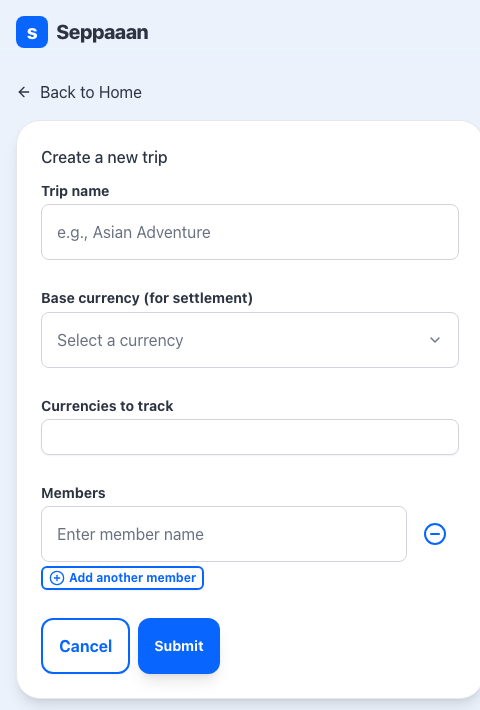
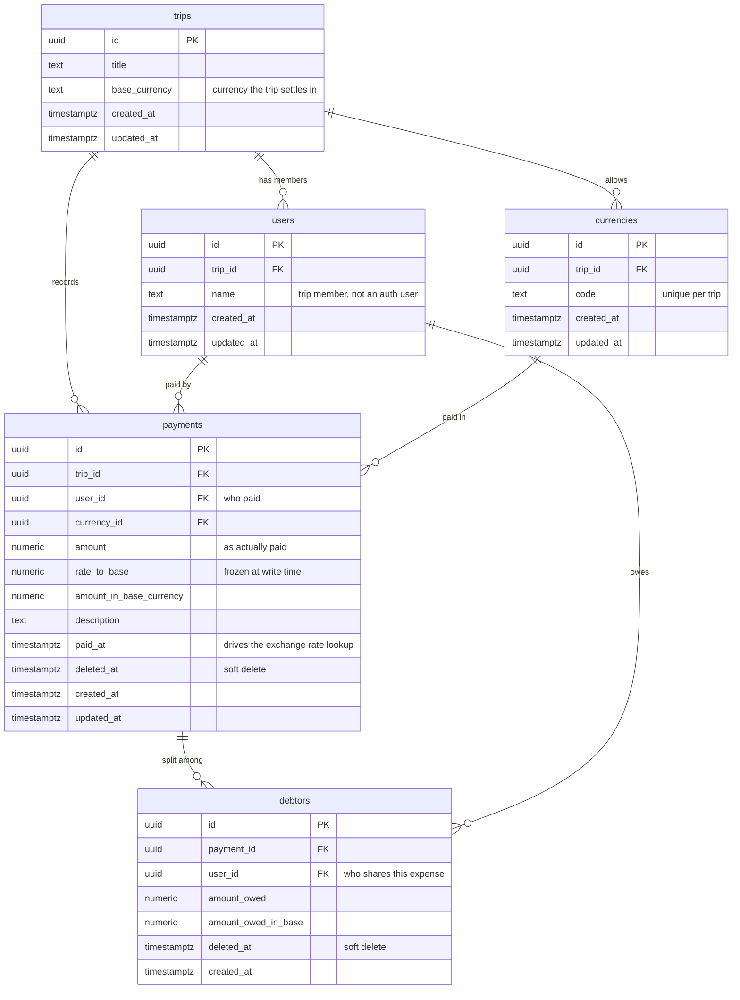

# 💸 Seppaaan

**Split expenses easily and fairly.**

Seppaaan is a no-sign-up group expense splitter for trips. ✈️ Create a trip with its
members and currencies, log every payment in whatever currency it was actually paid
in, and get back a minimized list of "who pays whom" in the trip's base currency.

### 🔗 [**Try it live → splitter.seppaaan.workers.dev**](https://splitter.seppaaan.workers.dev)


<p align="left">
  
  &nbsp;
  
</p>

---

## 🤔 Why

Splitting a trip's costs gets awkward the moment more than one currency is involved:
someone pays for the hotel in euros 🇪🇺, someone else covers dinner in yen 🇯🇵, and by
the end of the week nobody agrees on who owes what.

Seppaaan freezes the exchange rate at the moment each payment happened, converts
everything into one base currency, and then works out the **smallest set of transfers**
that settles the group.

## ✨ Features

| | |
| --- | --- |
| 🚪 **No account, no install** | A trip's URL is the only key you need. Create one, share the link, done. |
| 🌍 **Multi-currency by design** | Each trip has a base currency for settlement, plus any number of currencies you actually spend in. |
| 📅 **Historical exchange rates** | Rates come from the [Frankfurter API](https://frankfurter.dev) for the date the payment was made — not today's rate — and are stored on the payment, so totals never shift afterwards. |
| 🧑‍🤝‍🧑 **Uneven splits** | Pick exactly who shares each expense. The payer is only included if they were part of it. |
| 🤝 **Minimized settlement** | Instead of listing every debt, balances are netted out and the biggest payers are matched with the biggest receivers, so the group settles in as few transfers as possible. |
| 🗑️ **Soft deletes** | Removing a payment keeps the history intact. |

## 🧭 How it works

1. ✏️ **Create a trip** — name it, choose a base currency, pick the currencies you'll be
   spending in, and add members.
2. 🔗 **Share the link** — anyone with the trip URL can add expenses. No sign-up.
3. 🧾 **Log payments** — amount, currency, who paid, who it was for, and when. The rate
   to the base currency is fetched for that date and frozen onto the payment.
4. ✅ **Settle up** — the settlement screen shows the net balance per person and the
   shortest list of transfers that clears it.

## 🛠️ Tech stack

| Area | Choice |
| --- | --- |
| ⚛️ Framework | [Next.js 16](https://nextjs.org) (App Router, Server Actions) + React 19 |
| 🔷 Language | TypeScript |
| 🎨 Styling | Tailwind CSS v4, [shadcn/ui](https://ui.shadcn.com) on Radix / Base UI, `lucide-react` |
| 📝 Forms | React Hook Form + Zod |
| 🗄️ Database | [Supabase](https://supabase.com) (Postgres, RLS enabled) |
| ☁️ Hosting | [Cloudflare Workers](https://workers.cloudflare.com) via [`@opennextjs/cloudflare`](https://opennext.js.org/cloudflare) |
| 💱 Exchange rates | [Frankfurter API](https://frankfurter.dev) |

## 🏗️ Architecture notes

- 🔒 **All database access is server-side.** `src/lib/supabase.ts` exports a `server-only`
  Supabase client built with the service role key. The client is created lazily behind a
  Proxy so `next build` never needs the runtime secret.
- 🛡️ **RLS with no policies.** Every table has row level security enabled and no policies,
  so the anon key has zero access. Reads and writes go through Server Actions and
  Server Components only.
- 🔑 **The trip UUID is the access token.** There is no authentication, so every server
  action scopes its queries by `trip_id` and re-validates its input with the same Zod
  schema the client used.
- 📂 **Route-colocated features.** Each route under `src/app/trips/` keeps its own
  underscore-prefixed folders — `_actions/`, `_hooks/`, `_components/`, `_schema/`,
  `_types/`, `_utils/` — which are not routed by Next.js.

## 🗂️ Data model



A **trip** owns its members (`users`), the `currencies` it is allowed to spend in, and
its `payments`. Each payment names who paid and in which currency, and carries the
rate and base-currency amount frozen at the time it was written. One `debtors` row is
created per person sharing that payment — the payer included only if they were part of
it. Settlement reads nothing but the `*_in_base` columns, so historical rates never
move. `payments` and `debtors` are soft-deleted, so every query filters
`deleted_at IS NULL`.

## 📁 Project structure

```
src/
  app/
    page.tsx                  # 🏠 Landing page
    trips/
      new/                    # ✏️  Create a trip
      [id]/                   # 🧾 Trip detail + payments
        edit/                 # ⚙️  Edit trip settings
        settlement/           # 🤝 Balance calculation and settlement list
        share/                # 🔗 Shareable link
    privacy/, terms/          # 📄 Legal pages
  components/ui/              # 🎨 shadcn/ui components
  lib/supabase.ts             # 🔒 server-only Supabase client
  utils/get-exchange-rate.ts  # 💱 Frankfurter API client
supabase/migrations/          # 🗄️  Database schema
docs/                         # 📚 Privacy policy, terms, SEO guide, screenshots
```

---

## 🚀 Getting started

### 📋 Prerequisites

- **Node.js 20+**
- **[Supabase CLI](https://supabase.com/docs/guides/local-development)** and **Docker**
  — for running the database locally (or use a hosted Supabase project instead)

### 📦 Install

```bash
git clone https://github.com/kawa3saya/splitter.git
cd splitter
npm install
```

### 🗄️ Set up Supabase 🐳

Make sure **Docker Desktop is running**, then:

```bash
# 1. Install the Supabase CLI (macOS — see the docs for other platforms)
brew install supabase/tap/supabase

# 2. Create supabase/config.toml
#    It is git-ignored, so this step is needed after a fresh clone.
#    Your existing migrations and seed.sql are left untouched.
supabase init

# 3. Start Postgres, the API and Studio in Docker
supabase start

# 4. Apply every migration in supabase/migrations/ and load supabase/seed.sql
supabase db reset
```

`supabase start` prints the local URLs and keys — you'll need two of them for
`.env.local`:

```
         API URL: http://127.0.0.1:54321
      Studio URL: http://127.0.0.1:54323
service_role key: eyJhbGciOi...
```

Handy commands:

| Command | What it does |
| --- | --- |
| `supabase status` | 🔍 Print the URLs and keys again |
| `supabase stop` | 🛑 Stop the local stack |
| `supabase db reset` | ♻️ Wipe the **local** DB, re-apply migrations, re-seed |

Browse the data in **Supabase Studio** at
[http://127.0.0.1:54323](http://127.0.0.1:54323).

🌱 `supabase/seed.sql` creates three demo trips with members, multi-currency payments
and debtors. Since trips are reached by UUID, grab one from Studio or the SQL editor:

```sql
select id, title from trips;
```

Then open `http://localhost:3000/trips/<id>`.

> ☁️ Using a hosted Supabase project instead? Push the same migrations with
> `supabase link --project-ref <ref> && supabase db push`, and take the URL and
> `service_role` key from *Project Settings → API*.

### 🔑 Environment variables

Create a `.env.local` file in the project root:

```bash
NEXT_PUBLIC_SUPABASE_URL=http://127.0.0.1:54321   # or https://<project>.supabase.co
SUPABASE_SERVICE_ROLE_KEY=<your-service-role-key>
NEXT_PUBLIC_SITE_URL=http://localhost:3000
```

> ⚠️ `SUPABASE_SERVICE_ROLE_KEY` bypasses RLS. Keep it server-side only — never expose
> it to the browser or commit it. `.env*` and `.dev.vars` are both git-ignored.

### ▶️ Run

```bash
npm run dev
```

Open [http://localhost:3000](http://localhost:3000). 🎉

### 📜 Scripts

| Command | What it does |
| --- | --- |
| `npm run dev` | 🔥 Next.js dev server (Turbopack) with Cloudflare bindings wired up |
| `npm run build` | 📦 Production build; also type-checks |
| `npm run lint` | 🧹 ESLint (flat config, `next/core-web-vitals` + TypeScript) |
| `npm run preview` | 👀 OpenNext build + local Workers preview — closest to production |
| `npm run deploy` | 🚀 OpenNext build + deploy to Cloudflare Workers |
| `npm run cf-typegen` | 🧬 Regenerate `cloudflare-env.d.ts` from `wrangler.jsonc` |

There is no test suite — `npm run lint` and `npm run build` are the checks. ✅

## ☁️ Deployment

The app is deployed to Cloudflare Workers through `@opennextjs/cloudflare`. Worker
configuration lives in `wrangler.jsonc`, and runtime secrets are set with
`wrangler secret put` rather than committed. For local Workers development, secrets go
in a `.dev.vars` file, which is git-ignored.

```bash
npm run deploy
```

🌿 Branches: `main` is the integration branch, `stg` and `prod` are environment branches
that receive merges.

## 📚 Documentation

- 🔐 [Privacy policy](docs/privacy-policy.md) (Japanese)
- 📜 [Terms of service](docs/terms-of-service.md) (Japanese)
- 🔎 [SEO guide](docs/seo-guide.md) (Japanese)
